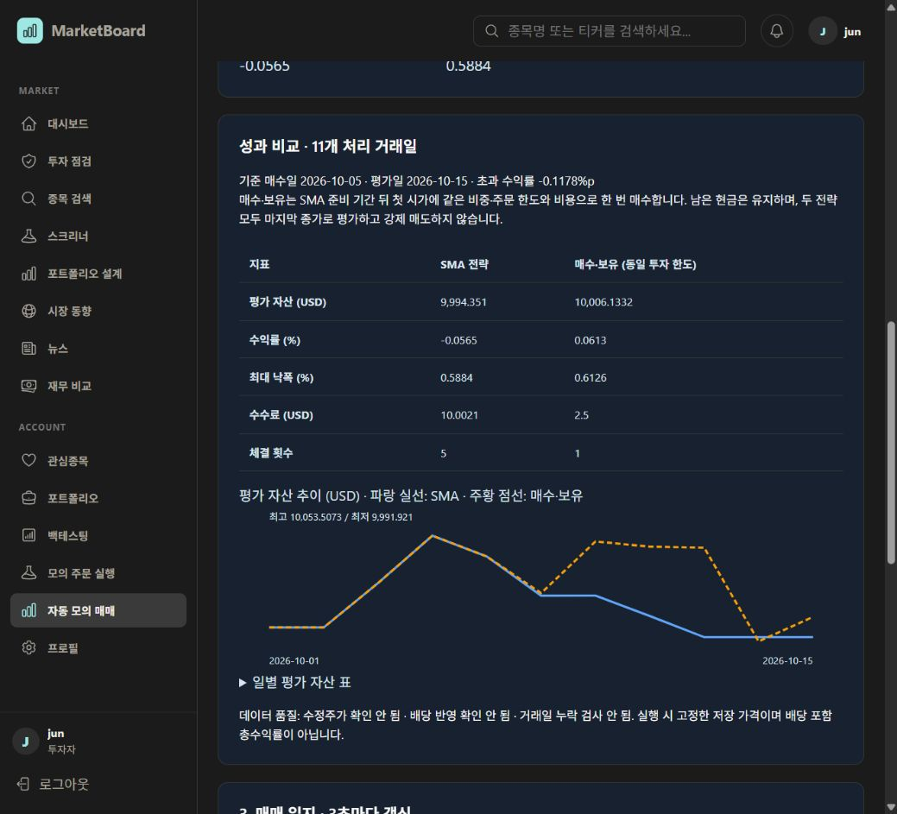

# 자동 모의 성과 비교 검증 — 2026-10-20

## 변경

저장된 실행의 처리된 가격 사본만 사용해 SMA와 동일 투자 한도의 매수·보유 성과를 비교한다. Python이 금융 지표를 계산하고 Spring은 소유권과 가격 사본 접근을 담당한다. 프론트엔드는 지표와 그래프를 표시한다. 기존 상태·일지는 변경하지 않는다.

규칙과 한계: [Auto_Trading_Spec.md](Auto_Trading_Spec.md)의 성과 비교 v1.

## 자동 검증

- Python 40개 통과: 자동 전략·수동 실행·API. 비교의 준비 기간, 매수 비용 일치, 종가 변경에 따른 체결 불변, 미래 가격 미사용, 최종 미청산, 무비용 고정 가격, 잘못된 가격 거부를 포함한다.
- Java 27개 통과: AutoTradingController 3, AutoTradingService 6, ExecutionController 9, ExecutionService 9. 이번 서비스 테스트는 H2와 실제 Python HTTP fixture를 사용했다. 저장 원본 가격 변경 후 비교, 기존 상태와 평가액 일치, 타인 실행 접근 거부 및 인증 경계를 검증했다.
- 변경 TSX ESLint 통과.
- 로컬 Docker backend/collector/frontend 재빌드·기동 완료. Next.js production build와 TypeScript 검사 통과.

## 실제 로컬 화면

사용자가 로그인한 기존 계정의 완료 실행 #3을 그대로 조회했다. MySQL에 저장된 11거래일 기록을 사용하며 새 실행이나 주문 기록을 만들지 않았다.

| 항목 | SMA | 동일 투자 한도 매수·보유 |
|---|---:|---:|
| 평가 자산 USD | 9,994.351 | 10,006.1332 |
| 수익률 % | -0.0565 | 0.0613 |
| 최대 낙폭 % | 0.5884 | 0.6126 |
| 수수료 USD | 10.0021 | 2.5 |
| 체결 횟수 | 5 | 1 |

- 기준 매수일 2026-10-05, 평가일 2026-10-15, 초과 수익률 -0.1178%p.
- 표, 파랑 실선·주황 점선 그래프, 수정주가·배당 미확인 및 누락 거래일 미검사 안내를 브라우저에서 확인했다.
- 브라우저 오류 로그 없음.
- 배당 포함 총수익률이나 투자 수익성의 근거가 아니다.

운영 서버 배포·커밋·푸시는 수행하지 않았다. 모바일 화면은 별도로 검증하지 않았다.
