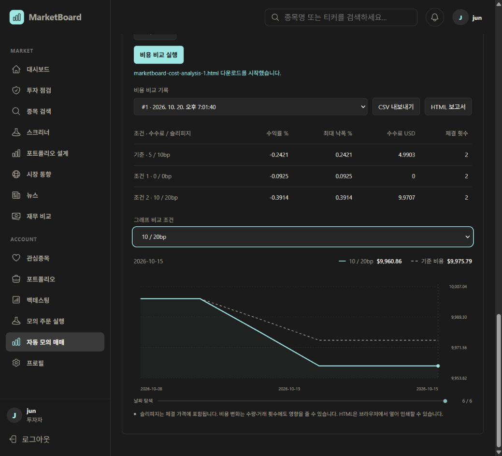

# 비용 비교·보고서 검증 — 2026-10-20

## 검증 결과

- Java 대상 테스트 35개 통과: AutoTradingService 13, AutoTradingController 3, ExecutionService 9, ExecutionController 9, CostReport 1.
- HTML 그래프 추가 후 AutoTradingService·CostReport 14개 재검증 통과.
- 프론트엔드 ESLint와 Docker production build/TypeScript 검사 통과.
- 실제 로컬 데이터베이스에서 V45 적용 후 비용 비교 기록 #1 저장 성공.
- 테스트에서 원본 `price_history` 삭제 후 비용 비교, DB 재연결 후 저장 결과 유지, 기준 결과 일치, 무비용 수수료 0, 중복 조건·범위 오류·요청 키 충돌 거부, 실패 롤백, 다른 계정 접근 차단을 확인했다.
- CSV 수식 방어, 따옴표 이스케이프, HTML 이스케이프, 외부 스크립트 없는 SVG 그래프를 검사했다.

## 실제 화면

기간 검증 #1의 동일 SPY 가격 2026-10-08~2026-10-15, SMA 2, 초기 자금 10,000 USD로 비교했다.

| 수수료 / 슬리피지 bp | 수익률 % | 수수료 USD | 체결 횟수 |
|---|---:|---:|---:|
| 5 / 10 (기준) | -0.2421 | 4.9903 | 2 |
| 0 / 0 | -0.0925 | 0 | 2 |
| 10 / 20 | -0.3914 | 9.9707 | 2 |

## 실제 다운로드

앱 버튼으로 다음 두 파일이 사용자의 Downloads 폴더에 생성되는 것을 다운로드 이벤트로 확인했다.

- `marketboard-cost-analysis-1.csv`
- `marketboard-cost-analysis-1.html`

파일을 직접 읽어 CSV의 UTF-8 BOM, 3개 조건과 실제 결과 값, HTML의 날짜·SVG 그래프·스크립트 미포함을 확인했다. 보관 사본:

- [CSV 예시](cost-report-example.csv)
- [HTML 예시](cost-report-example.html)

## 검증 한계

앱 화면의 표·그래프와 파일 다운로드 및 파일 내용은 검증했다. 독립 HTML 파일의 브라우저 렌더링은 확인하지 못했다. 전체 docs 디렉터리를 노출하는 임시 서버는 자동 승인 검토에서 범위가 넓다는 이유로 거절됐고, 로컬 file URL은 브라우저 정책에서 차단됐다. 샌드박스에서 시작한 임시 서버 세션은 종료했다.

운영 배포·커밋·푸시는 하지 않았다. 이 비교는 이미 사용한 검증 기간의 기능 확인 사례로, 새로운 데이터에 대한 독립 검증이나 미래 투자 수익성의 근거가 아니다.
