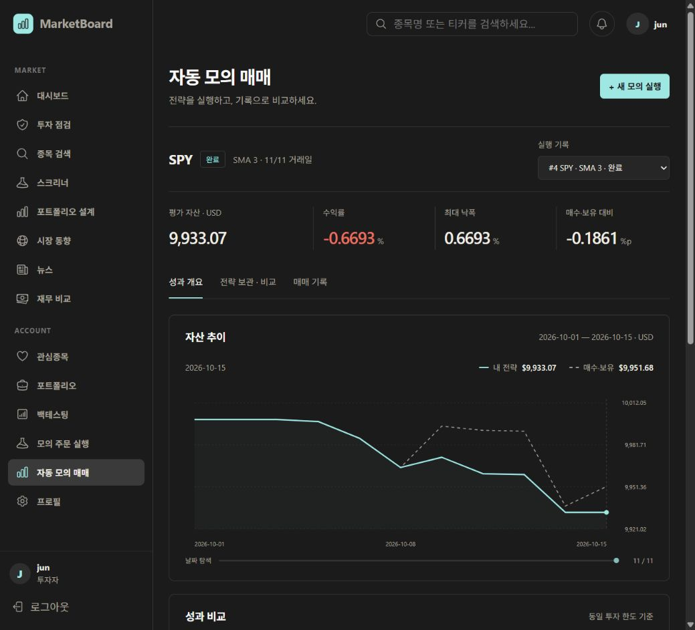

# 자동 모의 매매 화면 개선 — 2026-10-20

## 변경

- 설정 폼 중심의 긴 화면을 성과 개요 / 전략 보관·비교 / 매매 기록으로 분리했다.
- 첫 화면에 평가 자산, 수익률, 최대 낙폭, 매수·보유 대비 수익률을 배치했다.
- 공통 회색 배경과 민트 강조색을 사용한다. 독립된 파란 카드 배경을 제거했다.
- 자산 추이와 실행 간 비교에 같은 그래프를 사용한다. 민트 실선과 회색 점선, 가격축·날짜축·격자 및 날짜별 값 탐색을 제공한다.
- 새 실행 설정은 버튼으로 펼치며, 비교 규칙과 진행 방식은 세부 펼침 영역으로 옮겼다.
- 그래프 갱신 중 이전 그래프를 유지해 빈 화면으로 반복 전환되는 현상을 줄였다. 계산은 기존 서버 결과를 그대로 표시한다.

## 확인

- 실제 로그인 계정의 저장 실행 #4와 #3으로 성과 개요·전략 비교 그래프 확인.
- 그래프 날짜 슬라이더에서 Home 키로 첫날 선택 시 2026-10-01, 양쪽 10,000 USD 표시 확인.
- 매매 기록 11개에서 매수·매도 필터 적용 시 4개로 변경 확인.
- 새 실행 설정 열기 확인. 디자인 검증 중 새로운 실행·전략은 만들지 않았다.
- 데스크톱 로컬 Docker 화면 검증. 모바일은 반응형 CSS를 적용했으나 실제 기기 검증은 하지 않았다.

