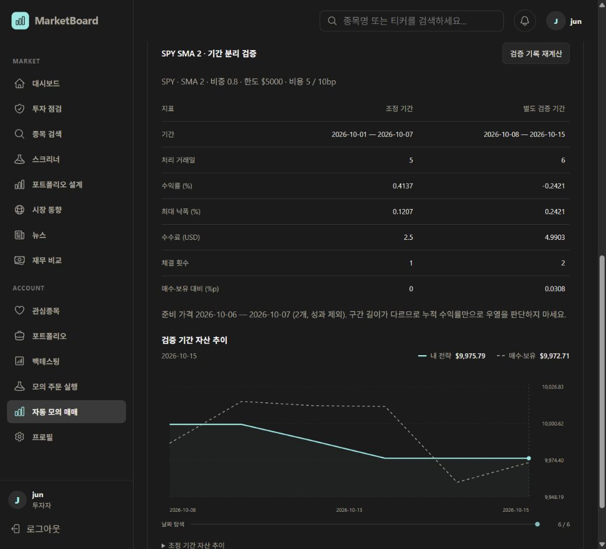

# 검증 기간 분리 검증 — 2026-10-20

## 범위

저장 전략을 고정하고 원본 조정 종료일 이후 기간에 초기 자금으로 별도 검증한다. 준비 가격은 신호 계산에만 사용하며 거래와 성과에서 제외한다. 결과·설정·가격은 영속화하고 재계산 검증을 제공한다. 전체 기간을 한 번에 계산하는 보고서이며 자동 실행 스케줄러와 별개다.

## 테스트

- Python 46개 통과: 기존 실행·API·자동 전략과 준비 가격 검증. 준비 가격 길이·정렬·중복/구간 중첩·가격 범위, 첫 검증일 진입, 초기 자금 재설정, 준비 구간의 성과 제외, 미래 가격 미사용, prefix 불변을 포함한다.
- Java 32개 통과: AutoTradingController 3, AutoTradingService 11, ExecutionController 9, ExecutionService 9. H2와 실제 Python HTTP fixture 사용.
- 서버 검증: 조정/검증 중첩 및 미래 날짜 거부, 준비/검증 가격 부족, 소유권, 중복 요청, 요청 키에 다른 기간 재사용 거부, 실패 롤백, DB 재연결, 원본 가격 삭제 후 재계산 일치.
- 프론트엔드 ESLint와 Docker production build/TypeScript 검사 통과.
- 로컬 MySQL V44 마이그레이션 적용 완료.

## 실제 로컬 흐름

- 조정 실행 #5: SPY, 2026-10-01~2026-10-07, SMA 2, 5거래일 완료.
- 저장 전략 #3: `SPY SMA 2 · 기간 분리 검증`.
- 검증 기록 #1: 2026-10-08~2026-10-15, 6거래일.
- 준비 가격: 2026-10-06~2026-10-07, 2개. 검증 성과·그래프에서 제외.
- 초기 자금 10,000 USD, 비중 0.8, 주문 한도 5,000 USD, 수수료 5bp, 슬리피지 10bp.
- 실제 화면의 **검증 기록 재계산**으로 두 구간 모두 저장 결과와 일치하는 것을 확인했다.
- 새로고침 후 검증 #1이 유지되며 재계산 결과가 다시 일치했다. 데스크톱 화면 가로 넘침 없음(1039/1039px).

| 지표 | 조정 기간 | 별도 검증 기간 |
|---|---:|---:|
| 거래일 | 5 | 6 |
| 수익률 % | 0.4137 | -0.2421 |
| 최대 낙폭 % | 0.1207 | 0.2421 |
| 수수료 USD | 2.5 | 4.9903 |
| 체결 횟수 | 1 | 2 |

이는 기능 검증을 위한 짧은 예시다. 앞선 화면에서 이미 확인한 날짜를 사용했으므로 이 예시를 처음 보는 데이터에 대한 독립적인 투자 검증이라고 주장하지 않는다.

기록은 확인용으로 남겼으며 기존 전략·매매 기록은 변경하지 않았다. 운영 배포·커밋·푸시는 하지 않았다.
