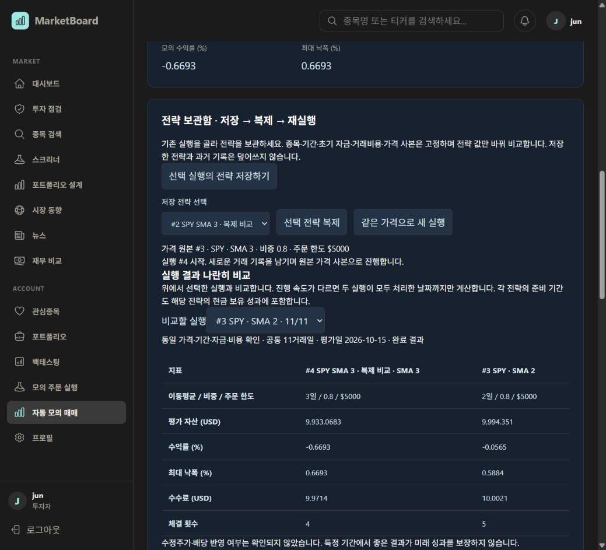

# 전략 저장·복제·재실행 검증 — 2026-10-20

## 구현

- 자동 모의 매매 화면에 전략 보관함과 실행 간 성과 비교를 추가했다.
- 기존 실행의 설정을 이름 붙여 저장하고, 이동평균·최대 비중·주문 한도·진행 간격을 수정해 별도 전략으로 복제한다.
- 재실행은 원본 실행의 전체 가격 사본을 재사용한다. 원본 기록·저장 전략은 수정하지 않는다.
- 계정별 소유권과 요청 키 중복 방지, 동일 조건 확인, 공통 처리 거래일까지의 비교를 서버에서 담당한다. 금융 계산은 기존 Python을 재사용한다.
- 동작 규칙: [Auto_Trading_Spec.md](Auto_Trading_Spec.md).

## 자동 검증

- Java 전체 대상 테스트 29개 통과: AutoTradingController 3, AutoTradingService 8, ExecutionController 9, ExecutionService 9.
- 추가 경계 단언 이후 AutoTradingService 8개 재실행 통과.
- H2와 실제 Python HTTP fixture로 다음을 검증했다.
  - 전략 저장·재실행 요청의 중복 방지와 다른 설정·전략으로 요청 키 재사용 거부
  - DB 재연결 후 저장 전략 유지
  - 원본 시장 가격 변경 후에도 동일 가격 사본 재실행 및 동일 설정 결과 일치
  - 원본 상태·일지·제어 이력 불변, 복제 전략 별도 저장 및 결과 차이
  - 다른 계정의 저장·실행·비교 대상 접근 차단
  - 공통 처리일만 비교, 비용·가격 사본 불일치 판정, 지나치게 긴 SMA 기간 거부
- 변경한 프론트엔드 파일 ESLint 통과.
- 로컬 Docker production build 및 Next.js TypeScript 검사 통과.
- 실제 로컬 MySQL에서 V43 마이그레이션 적용 완료, 기존 V42 기록 유지.
- `git diff --check` 통과.

## 실제 사용자 화면 검증

기존 로그인 세션으로 다음 흐름을 완료했다.

1. 완료 실행 #3에서 `SPY SMA 2 · 비교 기준` 전략 #1 저장.
2. 페이지 새로고침 후 저장 전략이 유지되는 것을 확인.
3. 전략 #1을 복제해 `SPY SMA 3 · 복제 비교` 전략 #2 저장. 이동평균만 2일에서 3일로 변경.
4. 같은 가격으로 새 실행 #4 시작. 11거래일 자동 진행 후 COMPLETED.
5. 실행 #4의 저장 기록 재생 검증: 11거래일 상태·매매 일지 전체 일치.
6. 실행 #4와 #3 비교: 동일 가격·기간·자금·비용 확인 및 완료 결과 표시.
7. 기간이 다른 기존 실행 #2를 비교 대상으로 선택했을 때 시작일·가격 사본 불일치 안내 확인. 원본 #3 비교로 복귀.

| 항목 | 복제 SMA 3 (#4) | 원본 SMA 2 (#3) |
|---|---:|---:|
| 평가 자산 USD | 9,933.0683 | 9,994.351 |
| 수익률 % | -0.6693 | -0.0565 |
| 최대 낙폭 % | 0.6693 | 0.5884 |
| 수수료 USD | 9.9714 | 10.0021 |
| 체결 횟수 | 4 | 5 |

평가일은 2026-10-15이며 11개의 동일 가격을 사용했다. 이 숫자는 기능 검증 사례이며 배당 포함 총수익률이나 투자 수익성 근거가 아니다.

브라우저 오류 로그 없음. 새 전략 2개와 완료 실행 #4는 확인 가능한 기록으로 남겼다. 자동 실행 중인 새 작업은 없다.

## 검증 범위

운영 배포·커밋·푸시는 하지 않았다. 모바일 화면은 별도로 검증하지 않았다. 저장 전략은 기존 실행에서 생성하는 방식이며, 독립적인 새 알고리즘·전략 삭제·학습/평가 기간 분리는 이번 범위에 포함하지 않는다.
