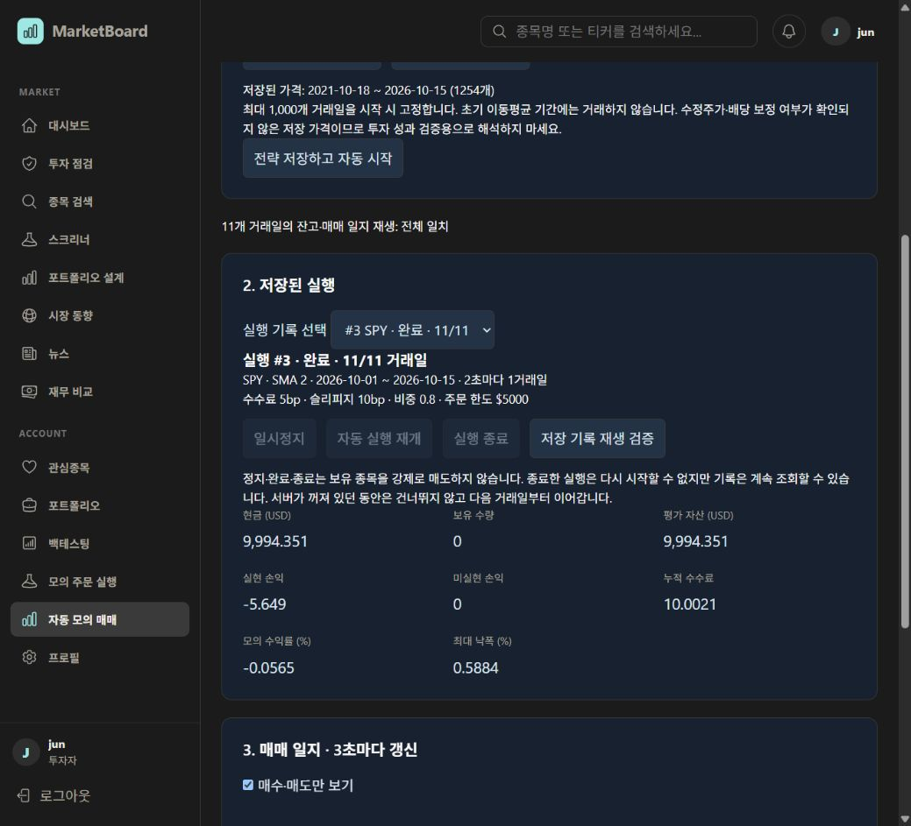
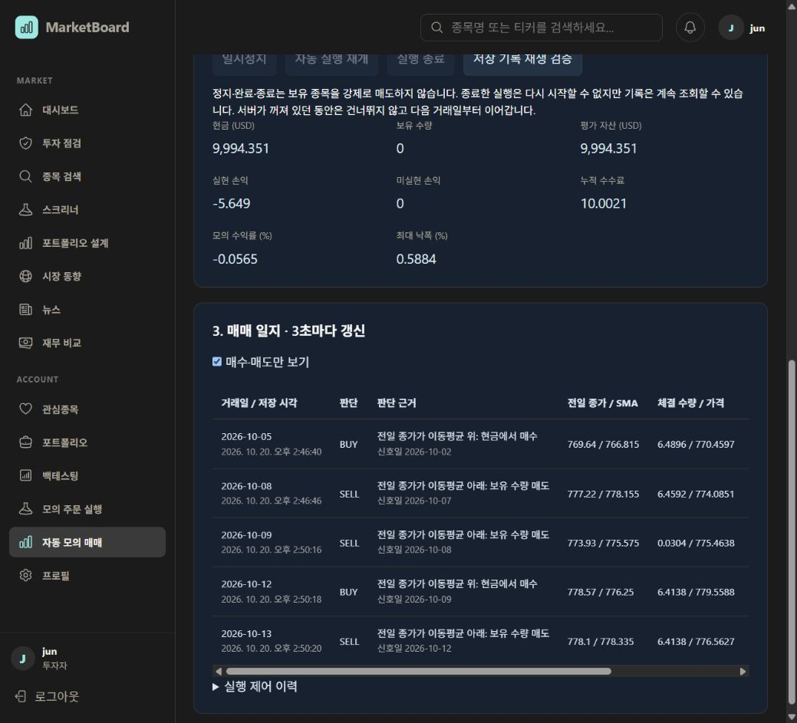

# 자동 모의 매매 검증

검증일: 2026-10-20 (Asia/Seoul). 로컬 검증이며 운영 배포 결과가 아니다.

## 자동 테스트

- Python 36개 통과: 자동 전략 10개 + 기존 실행/API 26개.
- Java 27개 통과: 자동 실행 서비스 6개·컨트롤러 3개 + 기존 실행 서비스 9개·컨트롤러 9개.
- 서비스 테스트 15개는 별도 MySQL 8.0 컨테이너에서 실제 Python reducer와 연결해 실행했다.
- 확인한 핵심 조건:
  - 신호가 현재·미래 종가를 참조하지 않으며 다음 시가로 체결됨.
  - 수수료·슬리피지, 주문 한도, 잔고 보존과 반복 재생의 결정성.
  - 가격 사본 생성 후 원본 가격을 수정해도 기존 실행 결과가 유지됨.
  - 동시 4개 작업자가 동일 실행을 처리해도 거래일 기록은 한 번만 저장됨.
  - 트랜잭션 롤백 시 실행 위치·일지가 함께 원상복구됨.
  - 일시정지·재개·종료 기록의 보존과 동일 요청 중복 방지.
  - 계산 서버 실패 시 위치·잔고·일지 유지 및 재개.
  - 인증 및 사용자 소유권 검사.
- 변경 TSX ESLint 통과. Docker production build에서 Next.js와 TypeScript 검증 통과.
- 실제 로컬 MySQL 8.4 서비스에서 Flyway 42개 이력 검증 및 V42 테이블 기동 확인.

재현:

```powershell
# collector
rtk proxy .\.venv\Scripts\python.exe -m pytest tests/test_auto_trading.py tests/test_execution.py tests/test_execution_api.py -q

# marketboardBackend
rtk proxy .\gradlew.bat test --tests "*AutoTrading*" --tests "*Execution*" --offline --console=plain
```

MySQL 재검증에는 전용 테스트 서버를 가리키는 `EXECUTION_TEST_MYSQL_URL` 및 `EXECUTION_TEST_MYSQL_PASSWORD`를 지정한다. 테스트는 `execution_test_` UUID 데이터베이스를 생성하고 정리한다. 기존 사용자 DB를 테스트 서버로 사용하지 않는다.

## 실제 브라우저 흐름

기존 로그인 세션, 실제 Spring Boot 인증·MySQL·Redis·Python·Next.js production 이미지를 사용했다.

1. 전략을 저장하면 별도 버튼 조작 없이 과거 거래일 기록이 자동 증가했다.
2. 실행 #1과 #2의 일시정지 및 재시작 후 보존을 확인했다. 검증이 끝난 두 실행은 기록을 남기고 종료했다.
3. 실행 #3: SPY, 2026-10-01~2026-10-15, SMA 2일, 진행 간격 2초, 초기 $10,000, 주문 한도 $5,000, 비중 0.8, 수수료 5bp, 슬리피지 10bp.
4. Python collector를 실제로 중단했다. 실행 #3은 6/11 거래일에서 ERROR로 정지했고 앞선 6개 기록을 유지했다.
5. backend·collector를 다시 기동하고 페이지를 새로고침해 동일 실행 및 오류 상태를 확인했다.
6. 재개 후 7번째 거래일부터 처리하여 11/11 완료. 매수 2회·매도 3회와 관망 6회가 기록됐다. 주문 한도 때문에 남은 소량의 보유분도 다음 매도 신호에서 처리됐다.
7. 저장 기록 재생 검증: **11개 거래일의 잔고·매매 일지 전체 일치**.
8. 매수·매도만 보기 필터와 종료된 기록 재조회 확인. 최종 화면의 가로 넘침 수정 후 body 너비/스크롤 너비 모두 1,039px, 수집된 브라우저 error 로그 0건.

화면 표시 기준 최종 자산 $9,994.351, 보유 0주, 누적 수수료 $10.0021, 모의 수익률 -0.0565%, 최대 낙폭 0.5884%. 이 값은 구현 재현 예제이며 전략 수익성의 근거가 아니다.





## 범위와 한계

- 실제 증권사·실시간 시세 API 및 외부 알림 발송 없음.
- 데이터의 수정주가·배당·분할 처리 여부는 확인되지 않았다.
- 과거 일별 봉을 순서대로 재생한다. 실시간 자동 운용이나 거래소의 체결 가능성·유동성을 재현하지 않는다.
- 데이터 끝에 보유분을 강제 청산하지 않는다.
- 대규모 작업 부하·운영 배포·모바일 기기 검증은 포함하지 않는다.

사용법과 상세 계약: [자동 모의 매매 명세](Auto_Trading_Spec.md).
