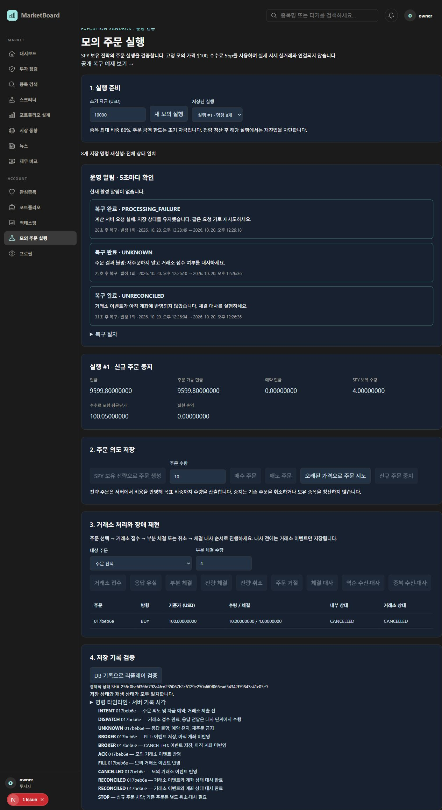

# P1 실행 운영 검증

검증일: 2026-10-20. 로컬 구현 및 검증 결과이며 운영 배포 결과가 아니다.

후속 통합 검증: 같은 날 실제 로그인·Redis·MySQL 8.4 환경에서 전체 Flyway 이력 검증, V38→V41 업그레이드, 재시작 후 기록 보존 및 모니터링 경보 복구를 확인했다. 아래 최초 검증의 제한을 보완한 근거는 [자체 모의 운영 기록](Execution_Simulation_Operations.md)에 있다.

## 구현 범위

- `/execution`: 계좌 상태, 주문 상태, 서버 기록 시각별 명령 타임라인, 리플레이 차이, 장애 발생·복구 이력을 조회한다. 5초 간격으로 갱신한다.
- V41 `execution_incidents`: 실행별·종류별 알림을 저장한다. 같은 조건이 지속되어도 중복 생성하지 않으며, 해소 시 복구 시각을 기록하고 재발 시 횟수를 증가시킨다.
- 알림 종류: UNKNOWN, UNRECONCILED, STALE_PRICE, RISK_BLOCKED, PROCESSING_FAILURE, REPLAY_MISMATCH.
- 계산 요청 실패는 명령 트랜잭션 롤백 이후 별도로 기록한다. 성공적인 재시도 또는 검증으로 처리 실패 조건을 해제한다.
- 리플레이는 전체 저장 상태를 비교하고 최대 50개의 JSON 경로별 차이를 반환한다. 불일치가 활성 상태이면 신규 명령을 차단하여 조사할 상태를 보존한다.
- `marketboard.execution.incidents`: 종류별 활성 알림 수를 15초 간격으로 집계하는 Micrometer gauge. 실행 ID나 사용자 ID를 태그로 넣지 않는다.
- `/execution-demo`: 로그인 없이 고정 예제의 결과를 읽는다. 실제 Python reducer를 호출하며 사용자 실행이나 계좌를 생성하지 않는다.

알림 전달 범위는 실행 화면 내부다. 이메일·메신저 발송이나 외부 경보 채널은 연결하지 않았다. 가격은 합성 SPY $100이며 실제 증권사 주문 API는 연결하지 않았다.

## API

| 요청 | 용도 |
|---|---|
| `GET /api/execution/demo` | 공개 읽기 전용 예제 |
| `GET /api/execution/{id}/incidents` | 소유자만 장애·복구 이력 조회 |
| `GET /api/execution/{id}/timeline` | 소유자만 저장 명령과 시각 조회 |
| `POST /api/execution/{id}/verify` | 전체 상태 재생 비교와 불일치 기록 |

기존 생성·명령 API와 동일하게 개인 실행에는 인증 및 소유권 검사를 적용한다.

## 검증 결과

- Java `ExecutionControllerTest` 9개, `ExecutionServiceTest` 9개: 실패·오류 0.
- Docker 재개 후 별도 MySQL 8.0.45 컨테이너에서 `ExecutionServiceTest` 9개를 다시 실행해 모두 통과했다. V40·V41 SQL 적용, 4개 동시 요청의 중복 방지, 롤백, 재연결 및 장애 복구를 포함한다. 서버의 performance_schema에서도 실행 테이블 생성 기록을 확인했다.
- 프런트엔드 production build(TypeScript 포함) 및 변경 TSX 파일 ESLint 통과. `git diff --check` 통과.
- 중복 알림 억제, 복구·재발, 소유권, 명령 시각, 처리 실패 복구, 상태 차이 및 불일치 중 쓰기 차단을 검증했다.
- 브라우저에서 공개 예제와 로그인 후 실행 흐름을 확인했다.
- 매수 10주 → 제출 → 응답 유실 → 4주 부분 체결 → 잔량 취소 → 역순 대사 → 중복 대사 → 신규 주문 중지.
- 결과: 현금 `9599.80000000`, SPY `4.00000000`, 예약 현금 `0.00000000`. 역순·중복 대사가 잔고를 중복 반영하지 않았다.
- UNKNOWN과 UNRECONCILED가 활성 알림에서 복구 완료로 전환되고 이력이 유지됐다.
- Python 서버를 실제로 종료한 뒤 검증 요청: 오류 표시 및 PROCESSING_FAILURE 저장. 재시작 후 검증 성공: 복구 완료(28초), 8개 저장 명령의 전체 상태 일치.
- Java 백엔드도 종료·재시작했다. 새로고침 후 동일 실행·잔고·복구 이력이 복원되었으며 8개 명령 재생이 다시 일치했다.

## 로컬 재현 환경

실제 실행 서비스·컨트롤러·Python reducer와 파일 기반 H2를 연결했다. 프리뷰 진입점과 로그인 fixture는 test 소스에만 존재하며 배포용 인증 구현을 대체하지 않는다.

1. collector 디렉터리:
   `rtk proxy .\.venv\Scripts\python.exe -m uvicorn tests.execution_preview:app --host 127.0.0.1 --port 18011`
2. marketboardBackend 디렉터리:
   `rtk proxy .\gradlew.bat -I ../scripts/execution-preview.gradle executionPreview --offline --console=plain`
3. frontend 개발 서버에 `NEXT_PUBLIC_API_BASE_URL=http://localhost:18091`을 프로세스 환경변수로 지정하고 `127.0.0.1:13110`에서 실행한다.

백엔드는 `127.0.0.1:18091`에만 바인딩한다. 테스트 계정은 `owner@example.test`, `other@example.test`, 공통 비밀번호는 `Preview-only-123!`이다. 모두 로컬 fixture이며 실제 서비스 계정이 아니다. DB 파일은 backend의 `build/execution-preview`에 저장된다.

MySQL 테스트는 `EXECUTION_TEST_MYSQL_URL=jdbc:mysql://127.0.0.1:13316/`과 `EXECUTION_TEST_MYSQL_PASSWORD`를 지정해 `ExecutionServiceTest`를 실행한다. 이 환경변수는 반드시 전용 테스트 DB 서버를 가리켜야 한다. 테스트마다 UUID가 붙은 `execution_test_` 데이터베이스를 생성·삭제한다. 이번에는 별도 `marketboard-execution-p1-test` 컨테이너를 사용했으며 기존 `mysql-container`는 변경하지 않았다.

## 검증 한계

- 처음에는 Docker 서비스 접근이 막혔으나 사용자가 실행한 뒤 MySQL 자동 테스트를 완료했다. 브라우저 검증은 H2 기반이며, 전체 Flyway 이력 업그레이드 및 운영 MySQL 배포 검증은 포함하지 않는다.
- 프리뷰는 실행 API만 제공한다. 공통 레이아웃의 시장 데이터 등 미구현 API는 404 HTML을 반환하여 콘솔 JSON 파싱 오류가 발생했다. 전체 서비스의 콘솔 무오류를 주장하지 않는다.
- 실제 계정·Redis 인증, 운영 스케줄링, 외부 경보, 실제 증권사 연결, 성능 부하 및 배포는 검증하지 않았다.
