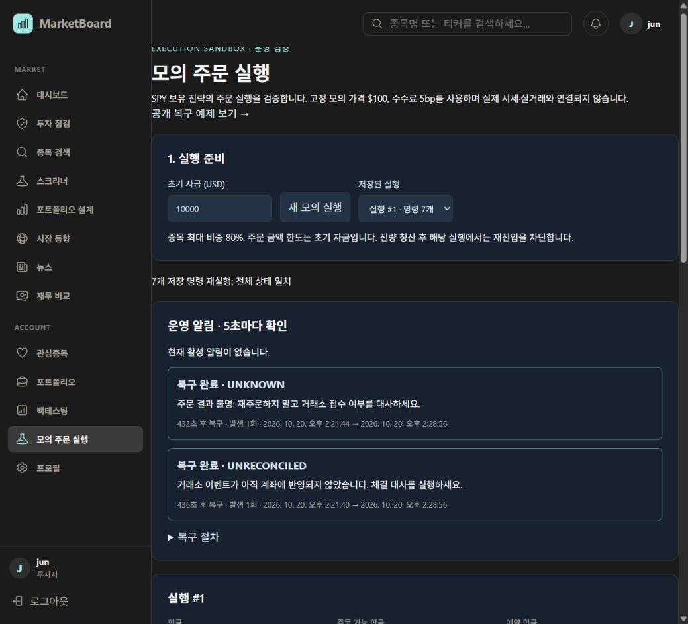
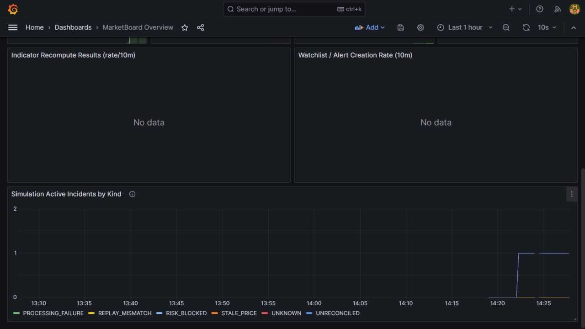

# 자체 모의 실행과 기록 운영

2026-10-20 사용자 결정: 증권사 API를 연결하지 않는다. Python의 내부 거래소 모델로 모의 주문·체결·장애를 재현하고, Spring과 MySQL이 사용자별 실행 및 복구 이력을 보관한다.

## 실행

```powershell
rtk docker compose -f compose.local.yml -f compose.execution.yml up -d --build
```

- 앱: http://localhost:13100/execution
- 공개 예제: http://localhost:13100/execution-demo
- Prometheus: http://localhost:19091
- Grafana: http://localhost:13301

일반 서비스의 로그인/Redis 인증을 사용한다. 모의 계좌를 생성한 뒤 주문 저장, 내부 거래소 접수, 체결 또는 취소, 대사를 순서대로 수행한다. 응답 유실을 재현했을 때는 재주문 대신 대사를 실행한다.

`저장된 실행`에서 이전 실행을 다시 선택할 수 있다. 설정, 명령 순서와 서버 시각, 잔고, 장애 발생·복구 시각이 MySQL에 남는다. `DB 기록으로 리플레이 검증`은 저장된 전체 명령으로 상태를 다시 계산해 비교한다.

`/execution`의 장애 검증 명령은 사용자가 화면에서 진행하며 가격은 고정 합성 SPY $100이다. 이후 추가한 `/auto-trading`에서는 전략을 설정하면 서버가 저장된 과거 가격을 순서대로 재생하고 모의 매매 일지를 자동 기록한다. 상세 사용법과 규칙은 [자동 모의 매매 명세](Auto_Trading_Spec.md)를 참고한다.

## 외부 연결 범위

이 compose 조합은 collector를 `app.execution_main:app`으로 실행한다. 수동·자동 모의 replay와 health를 제공하며 시세 WebSocket, REST fallback, 일별 수집 작업을 시작하지 않는다. 일반 사이트 화면은 기존 DB에 저장된 시장 데이터를 표시할 수 있다.

모의 주문은 외부 거래소로 전송되지 않는다. 일반 서비스의 기존 기능과 모의 실행 기능은 별개다.

## 모니터링

- `marketboard_execution_incidents{kind="..."}`: 종류별 활성 모의 장애 수. 15초 간격으로 DB에서 집계하며 Prometheus도 15초 간격으로 수집한다.
- Grafana의 MarketBoard Overview에 `Simulation Active Incidents by Kind` 패널을 추가했다.
- `ExecutionIncidentPersistent`: 같은 종류의 활성 장애가 2분 이상 있으면 경보 상태가 된다. 개인 실행 ID는 지표에 포함하지 않으며, 세부 복구 작업은 각 사용자의 `/execution`에서 수행한다.
- 로컬 구성은 외부 알림 수신자를 설정하지 않는다. 경보는 Prometheus에서 확인한다. Grafana의 기존 외부 전송용 alerting 디렉터리는 이 구성에 마운트하지 않는다.
- 로컬 Grafana 계정: `simulation-admin` / `simulation-local-only`. 루프백 포트의 개발 환경 전용이다.

규칙 검증:

```powershell
rtk docker exec marketboard-local-prometheus-1 promtool check rules /etc/prometheus/execution-rules.yml
rtk docker cp observability/execution-rules.test.yml marketboard-local-prometheus-1:/tmp/execution-rules.test.yml
rtk docker exec marketboard-local-prometheus-1 promtool test rules /tmp/execution-rules.test.yml
```

## 보관과 중지

MySQL은 기존 `local-mysql-data` named volume에 기록을 보관한다. 컨테이너 중지·재시작은 기록을 삭제하지 않는다. `down -v`는 사용하지 않는다.

```powershell
rtk docker compose -f compose.local.yml -f compose.execution.yml stop
```

Grafana와 Prometheus의 로컬 저장소는 임시다. 업무 기록의 원본은 MySQL이며 장기간 메트릭 보관은 이번 범위에 포함하지 않는다.

## 통합 검증

- MySQL 8.4.11의 기존 V38 DB에서 전체 41개 마이그레이션 검증 성공, V39·V40·V41 업그레이드 성공.
- 실제 Spring Boot 앱, Redis, MySQL, 독립 Python 모의 서버 및 Next.js production 이미지 기동.
- Python 실행 테스트 26개 통과.
- Prometheus target `up`, 실제 UNKNOWN·UNRECONCILED 발생 시 각각 1로 집계되는 것을 확인.
- promtool 구문 검사 및 2분 지속/복구 해제 테스트 통과.
- 사용자가 직접 로그인한 실제 계정에서 실행 #1 생성 → 매수 10주 → 접수 → 응답 유실 → 4주 부분 체결을 기록했다.
- backend와 collector 컨테이너 재시작 후 동일 실행·주문·장애 이력이 복원됐다. 이후 잔량 취소, 역순 대사, 중복 대사를 기록했다.
- 최종 현금 `9599.80000000`, 보유 `4.00000000`, 예약금 `0.00000000`. 7개 저장 명령의 전체 상태 리플레이가 일치했다.
- 실제 Prometheus 경보가 UNKNOWN·UNRECONCILED 각각 `firing`으로 전환되는 것을 확인했다. 대사 후 모든 장애 지표가 0, 경보 `inactive`로 복구됐다.
- Grafana 패널 렌더링 확인. 실제 앱 브라우저 콘솔의 수집된 error 로그는 0건이었다.





이 문서의 검증은 로컬 환경이다. 운영 배포·실거래·외부 알림 발송은 수행하지 않았다.
