# MarketBoard 개선 계획 1차 검증

> 후속 구현(2026-10-22): 아래는 수정 전 관측 기록이다. 로딩·오류 처리 후속 작업과 로컬 검증 결과는 문서 끝의 ‘후속 구현’에 기록했다. 운영 배포는 수행하지 않았다.

- 검증일: 2026-10-22 (Asia/Seoul)
- 대상: https://marketboard.duckdns.org 및 현재 로컬 작업 트리
- 기준: `MarketBoard_Improvement_Plan.md`의 1단계 현황 검증
- 변경 범위: 이 보고서와 증거 파일만 추가. 제품 코드 수정·배포 없음.

## 결론

실제 화면에서 카드·버튼의 과도한 줄바꿈, 공통 메타데이터, 뉴스 반복 콘텐츠, 데이터 시점 표시 부족을 확인했다. 로컬 코드에서는 주요 지수 실패 후 스켈레톤 유지, 오류와 빈 결과 혼동, 로그인 복귀 경로 유실을 확인했다. 정상 화면의 차트 검은 글자 문제는 이번 환경에서 재현되지 않았다.

**1차 검증 결과이며 모든 상태의 통과 판정은 아니다.** 네트워크 장애·장시간 지연의 브라우저 재현, 밝은 모드/강제 다크모드 비교, 비로그인→로그인 완료 후 복귀, 실제 공유 카드 확인은 남아 있다.

## 환경과 증거 구분

- 브라우저: Codex in-app browser, 기존 로그인 세션 사용. 로그아웃·계정 변경·관심종목 변경 없음.
- 화면 크기: 데스크톱 1440×1000, 작은 모바일 360×800, 큰 모바일 430×932. 물리 휴대폰 검증은 아니다. 검증 후 viewport override 복원.
- 현재 사이트는 `color-scheme: dark`이며 UI에서 테마 전환을 확인하지 못했다. 로컬 `globals.css`에도 dark 지정이 있다.
- HTTP: Python 표준 라이브러리로 쿠키 없이 공개 경로 GET. 최초 sandbox DNS 실패 후 허용된 네트워크 실행으로 성공.
- 로컬 작업 트리에 기존 변경이 다수 있다. 특히 `frontend/src/lib/api.ts`도 기존 수정 파일이다. 로컬 코드 결과를 배포 코드와 동일하다고 가정하지 않는다.
- 응답 시간은 단일 HTML 요청의 관측값이며 API 성능·사용자 체감 속도·SLA를 의미하지 않는다.
- 과거 검토나 저장된 화면을 결함 근거로 사용하지 않았다.

## 실제 화면 검증 순서

| 단계 | 경로·조건 | 결과 | 증거 |
| --- | --- | --- | --- |
| 1 | 대시보드, 1440px | 정상 데이터·차트 표시. 오른쪽 공포/보합 글자 단위 줄바꿈, 차트 아래 큰 여백 | 01 |
| 2 | 메뉴 → 시장 동향, 1440px | 정상 진입. 대시보드와 심리·시장 폭·섹터 중복, 섹터 제목 중복 | 02 |
| 3 | 시장 동향, 360px | 공포/보합 줄바꿈 재현. 문서 전체 가로 넘침 없음. 섹터 표는 내부 스크롤 구조 | 03 |
| 4 | 모바일 메뉴 → 종목 검색, 360px | 메뉴 진입·목록 표시 정상. 전체/관심종목 버튼 줄바꿈. 많은 열은 가로 스크롤 필요 | 04 |
| 5 | 목록 검색에 `ZZZZ_NO_SUCH_TICKER` 입력 | ‘검색 결과가 없습니다’ 표시 정상. 검색을 NVDA로 바꾸면 결과 복구 | 05 |
| 6 | NVDA 링크 Enter → 상세, 430px | 로그인 상태에서 상세 진입 정상. 차트 표시. 갱신 시각은 ‘—’, 기간/일봉/분봉 버튼 줄바꿈 | 06 |
| 7 | 모바일 메뉴 → 뉴스, 1440px | 뉴스 표시 정상. Reuters 큰 이미지 반복 및 제목과 사실상 같은 설명 반복 | 07 |

## 우선순위별 발견 사항

### V01. 주요 지수 실패·빈 배열에서 스켈레톤이 종료되지 않는 코드 경로

- 연결 계획: A02, A03. 수정 우선순위 높음.
- 근거 수준: **로컬 정적 코드 확인**, 운영 장애를 주입한 재현은 아님.
- `frontend/src/components/dashboard/MarketOverview.tsx:16`: 요청 실패를 `catch(() => undefined)`로 무시한다.
- 같은 파일 22행: `indices.length === 0`이면 스켈레톤을 계속 표시한다. 실패와 정상 빈 배열 모두 같은 결과다.
- `frontend/src/lib/api.ts:103`에 공통 10초 타임아웃은 이미 있다. 따라서 ‘타임아웃이 전혀 없다’가 아니라, 종료된 요청에 맞춰 화면 상태가 바뀌지 않는 문제다. 인증 갱신/재요청은 별도 시간이 들 수 있다.
- 수정 기준: loading/error/empty/success 분리, 실패 안내와 영역별 재시도, 정상 빈 배열 안내. 500·단절·시간 초과·빈 배열로 브라우저 재현 필요.

### V02. 오류가 빈 결과·사라진 카드·빈 차트로 바뀜

- 연결 계획: A02. 근거 수준: **로컬 정적 코드 확인**.
- `NewsPanel.tsx:28`: 실패를 빈 배열로 바꿔 ‘뉴스가 없습니다’ 표시.
- `MainIndexChart.tsx:25`: 실패를 빈 candles로 처리하며 오류 안내·재시도 없음.
- `MarketBreadthPanel.tsx:73`: 실패 시 `return null`.
- `MarketSentimentPanel.tsx:107`: 두 데이터가 없으면 로딩/실패 구분 없이 숨김.
- `SectorRotationTable.tsx:57`: 빈 결과와 실패 모두 숨김.
- `stock-list/page.tsx:103`: 종목 조회 실패를 빈 배열로 처리.
- `MacroMarketGrid.tsx`는 `Promise.all` 후 한 번에 반영하므로 가장 느린 요청까지 거시 카드 전체 수치 반영이 대기한다.
- 수정 기준: 없는 자료와 가져오지 못한 자료를 구분하고, 실패한 영역만 재시도하도록 구성.

### V03. 고정 2열 카드와 좁은 버튼의 가독성

- 연결 계획: A01, A08. 근거 수준: **실제 화면 재현** (01, 03, 04, 06).
- 데스크톱 대시보드의 좁은 우측 패널과 360px 시장 동향에서 공포·보합이 한 글자씩 끊긴다.
- `MarketBreadthPanel.tsx:77`, `MarketSentimentPanel.tsx:110`의 2열 Grid가 좁은 컨테이너에서도 유지된다.
- 360px 종목 검색의 전체/관심종목, 430px 상세의 기간·차트 단위 버튼도 줄바꿈된다.
- 360px 시장 동향: 문서 clientWidth/scrollWidth 모두 345. 섹터 표는 부모 285px / 내용 552px / overflow-x:auto. 표 내부 스크롤 자체는 결함으로 판정하지 않았다. 실제 터치 스와이프는 미검증.
- 430px 상세: 문서 clientWidth/scrollWidth 모두 415. 화면 밖 페이지 넘침은 관측하지 않았다.
- 수정 기준: 카드의 실제 가용 폭에 따라 1열 전환, 버튼 최소 폭·줄바꿈 정책 조정.

### V04. 경로별 메타데이터와 공유 태그 누락

- 연결 계획: A07, A12. 근거 수준: **쿠키 없는 운영 HTTP 응답 + 브라우저 DOM**.
- `/dashboard`, `/market`, `/stock-list`, `/news`, `/symbols/NVDA`, `/terms` 모두 HTTP 200.
- 모든 확인 경로 title=`MarketBoard`, description=`실시간 종목 리스트`.
- 위 응답에 OG meta와 canonical 링크 없음.
- 앞의 5개 경로는 script/style을 제외한 초기 HTML 텍스트가 `MarketBoard 불러오는 중`. 현재 로컬 `RequireAuth`의 초기 인증 대기와 부합한다. `/terms`는 본문이 초기 HTML에 있다.
- 이는 공개 본문 사전 렌더링이 부족하다는 증거다. 검색 엔진에서 반드시 검색 불가라는 뜻은 아니다.
- 수정 기준: 페이지별 title/description/canonical/OG 우선 적용. 공개 페이지의 인증 대기와 사전 렌더링 범위는 별도로 설계.
- 원본 요약: [public-html.json](improvement-verification-2026-10-22/public-html.json), 재실행 도구: [probe_public.py](improvement-verification-2026-10-22/probe_public.py).
- 실제 카카오/Slack 등 공유 서비스 미리보기는 미검증.

### V05. 데이터 기준 시점과 연결 상태를 해석하기 어려움

- 연결 계획: A05. 근거 수준: **실제 화면 확인** (01, 02, 06).
- 주요 지수·거시 카드·시장 폭에 개별 기준 일시/시간대/출처/지연 상태가 충분히 표시되지 않는다.
- 대시보드 차트에는 `2026. 10. 20. 4시 0분 0초 UTC`와 OHLC·거래량 텍스트가 있어 긍정적이다.
- NVDA 상세 현재가 221.97과 차트 마지막 봉 종가 216.47은 서로 다르며 ‘갱신 시각’은 `—`였다. 시점이 다른 자료일 수 있으므로 가격 오류로 단정하지 않는다. 차트/시세의 시점을 각각 명확히 해야 한다.
- 종목 목록은 ‘실시간 연결됨’을 표시했다. WebSocket 연결 성공만으로 모든 가격의 최신성을 증명할 수는 없다.

### V06. 로그인 후 원래 화면 복귀 경로가 없음

- 연결 계획: A06. 근거 수준: **로컬 정적 코드 확인**.
- `RequireAuth.tsx:18`: 내부 경로 보존 없이 `/login`으로 이동.
- `login/page.tsx:35`: 로그인 성공 후 `/review`로 고정 이동.
- `oauth/callback/page.tsx:26`: OAuth 성공도 `/review`로 이동.
- 로그인된 상태의 종목 검색→NVDA 상세는 실제로 성공했다. 기존 세션을 유지했기 때문에 비로그인 리다이렉트 및 로그인 완료 후 복귀를 이번 브라우저에서 재현하지 않았다.
- 수정 기준: 허용된 내부 returnTo와 필요한 작업 맥락 보존. 외부 URL·인증 정보 URL 포함 방지.

### V07. 고지는 존재하지만 주요 화면에서 찾기 어려움

- 연결 계획: A08 및 계획 9절. 근거 수준: **실제 화면 + 운영 HTTP + 코드**.
- `/terms`에는 투자 권유 아님, 지연·부정확 가능성 등의 문구가 실제 HTML로 제공된다. ‘고지가 전혀 없다’는 판단은 잘못이다.
- 확인한 대시보드·시장 동향 전체 화면에 공통 정보 이용 고지가 없었다. 뉴스 DOM에서도 footer 0개, `/terms` 링크 0개였다.
- 수정 기준: 주요 앱 화면의 짧은 고지·약관 접근 경로와 지표 근처 시점 표시를 함께 제공. 법적 적합성과 출처별 표시 의무는 별도 확인.

### V08. 정보 중복과 뉴스 반복

- 연결 계획: A04, A09, A10. 근거 수준: **실제 화면 확인** (01, 02, 07).
- 대시보드와 시장 동향에 시장 폭·심리·섹터 전체 표가 반복되고 섹터 제목이 두 번 나온다.
- 섹터 1일/1주/1개월은 이미 존재한다. 기간 데이터 부재로 판단하면 안 된다.
- 뉴스 출처·발행 시각은 이미 표시된다. 일부 Reuters 기사는 제목과 설명이 사실상 중복이고 큰 이미지가 반복된다.
- 수정 기준: 대시보드는 요약·진입점, 시장 동향은 상세 비교. 뉴스 중복 설명/이미지 우선 축소.

## 통과한 부분과 남은 검증

확인된 긍정적 사항: 정상 상태에서 영역별 데이터가 표시됨, 선택 봉 OHLC 텍스트 제공, 등락 부호 제공, 모바일 메뉴 이동, 검색 빈 결과와 결과 복구, Enter를 통한 상세 진입, 표 내부 스크롤 구조, 뉴스 출처·발행 시각, 약관 내 고지.

| 남은 항목 | 현재 한계 | 다음 검증 |
| --- | --- | --- |
| 500/단절/10초 초과 지연 | 현재 지원 브라우저 API에 요청 차단·offline·응답 지연 주입 기능이 없음. 정적 코드 근거만 확보 | 로컬 격리 환경의 API 오류/지연 fixture로 화면 종료·재시도 검증 |
| 밝은 모드/강제 다크모드 | 현재 dark 화면만 관찰. OS/확장/브라우저 강제 색상 변경을 수행하지 않음 | 동일 경로·화면 폭으로 환경별 캡처 비교 |
| 로그인 복귀 | 로그인된 기존 세션을 유지 | 별도 비로그인 환경에서 상세→로그인 성공/실패/취소 검증 |
| 접근성 전반 | 일부 키보드 진입·텍스트/부호만 확인 | 전체 Tab 순서, 초점 표시, 화면낭독기, 대비 계산, reduced-motion, 확대 확인 |
| 실제 휴대폰/확대 | viewport만 변경 | 터치 표 스크롤·차트 툴팁·200% 확대 확인 |
| 공유 미리보기 | HTML 태그만 확인 | 태그 개선 후 실제 공유 서비스 캐시/이미지 확인 |
| 데이터 정확도/법적 조건 | 표시와 응답 상태 중심 | 원천 시각·계산·수집 일정 및 제공자 조건 대조 |

## 다음 수정 순서

1. V01/V02 오류·빈 결과·로딩 상태 분리와 영역별 재시도.
2. V03 좁은 카드·버튼 레이아웃 수정, V05 시점·출처 표시.
3. V06 로그인 맥락 보존, V04 경로별 메타데이터, V07 공통 고지 접근.
4. V08 화면 역할·뉴스 중복 정리. 사전 렌더링과 섹터 확장은 이후 검토.

## 화면 증거

### 01 대시보드 데스크톱
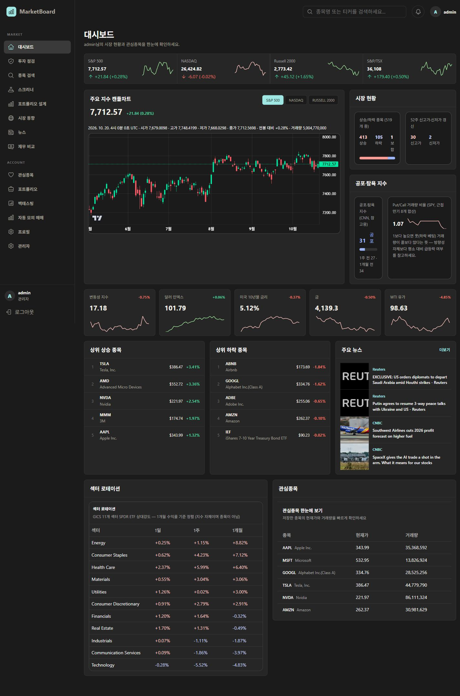

### 02 시장 동향 데스크톱
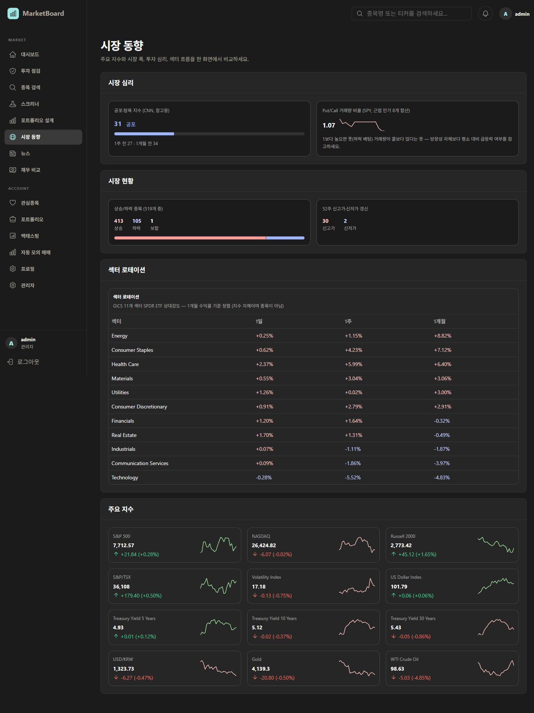

### 03 시장 동향 360px
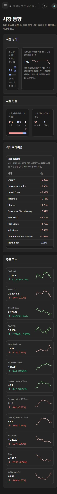

### 04 종목 검색 360px
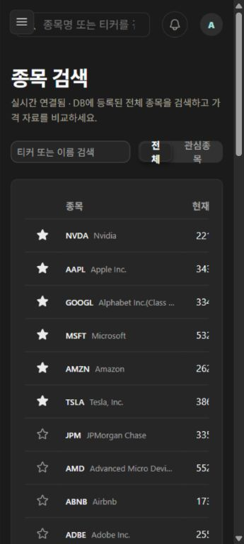

### 05 검색 빈 결과
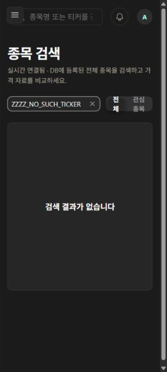

### 06 NVDA 상세 430px
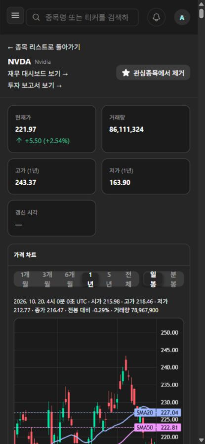

### 07 뉴스 데스크톱
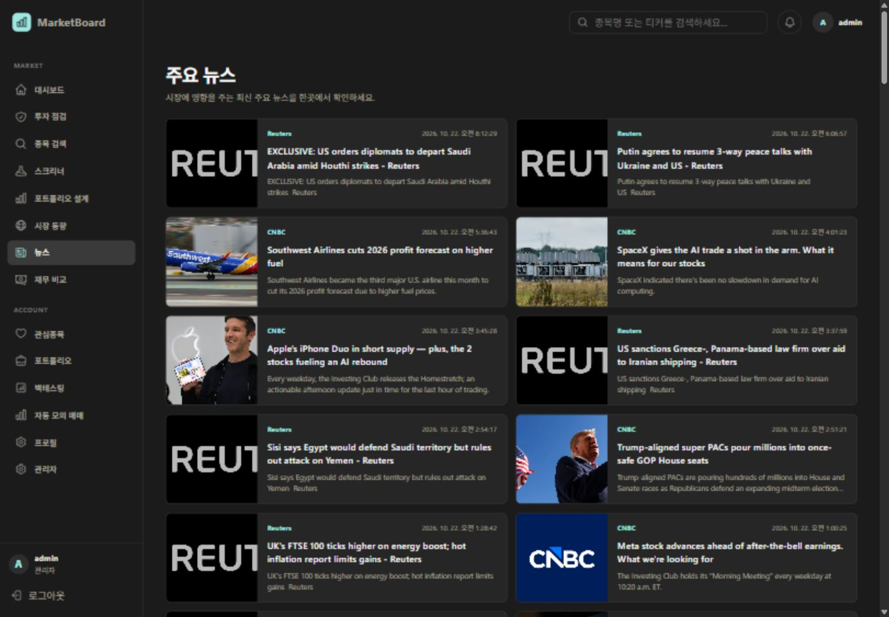

## 후속 구현: 로딩·오류·재시도 (2026-10-22)

### 변경

- `useResource`로 로딩·성공·오류를 분리하고 성공한 빈 응답은 각 화면의 빈 결과 안내로 처리한다.
- 주요 지수 목록, 개별 지수, 지수 차트, 거시 카드, 상승/하락 종목, 시장 폭, 심리, 섹터, 뉴스, 종목 카탈로그에 적용했다.
- 오류 시 해당 영역에 ‘다시 불러오기’를 제공한다. 자동 재시도는 추가하지 않았다. 연속 클릭은 진행 중 요청을 중복 생성하지 않는다.
- 이 읽기 전용 영역의 요청에는 10초 제한과 unmount/조회 대상 변경 시 취소를 적용했다. 이전 조회 결과 및 다른 계정의 결과가 새 화면을 덮지 않게 처리했다.
- 거시 카드별로 결과를 반영한다. 가장 느린 카드 때문에 다른 카드의 표시가 대기하지 않는다.
- 상승/하락 종목은 일부 가격 이력 실패 시 불완전한 순위를 보여 주는 대신 오류를 표시한다. 일부 외부 이력 실패로 이 영역 전체가 재시도를 요구할 수 있다.
- 시장 폭·심리 카드의 좁은 컨테이너에서는 1열로 배치해 상태 안내도 읽을 수 있게 했다.
- 로딩 상태의 스켈레톤은 reduced-motion 설정을 따른다. 전체 A03 레이아웃 이동 최소화 작업을 완료했다는 의미는 아니다.

### 검증

| 검증 | 결과 |
| --- | --- |
| TypeScript `tsc --noEmit` | 통과 |
| 변경 영역 ESLint | 통과 |
| 상태 처리 3개 + 기존 인증 갱신 5개 Node 테스트 | 8개 통과 |
| `npm run build` | 프로덕션 빌드 및 31개 정적 페이지 생성 통과 |
| `git diff --check` | 통과 |
| 로컬 브라우저 + 격리 HTTP fixture | 주요 지수 503 → 오류 표시 → 수동 재시도 → 성공 |
| 로컬 브라우저 + 12초 지연 fixture | 뉴스 요청 시간 초과 → 오류 표시 → 재시도 → 정상 빈 결과 |
| 로컬 브라우저 정상 영역 | 오류 영역과 함께 차트·거시 카드가 표시됨 |

Node 테스트는 빈 응답/실패/재시도, 연속 클릭 중복 방지, 조회 대상 변경 시 이전 결과 무시, 취소·시간 초과, 계정 변경 시 이전 결과 숨김을 확인한다. React 브라우저 마운트의 대체물은 아니며 위 브라우저 검증을 별도로 수행했다.

사용한 fixture: `frontend/tests/resource-http-fixture.py` (127.0.0.1:18081 전용). 프런트는 별도 프로세스의 `NEXT_PUBLIC_API_BASE_URL=http://127.0.0.1:18081`로 3101 포트에서 실행했다. 환경 파일·운영 API·DB는 변경하지 않았다. 아래 캡처는 가상 데이터이며 투자 자료가 아니다.

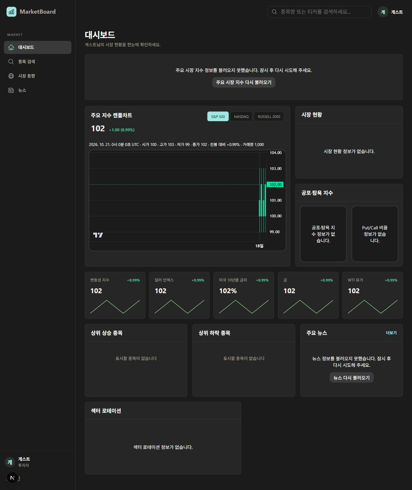
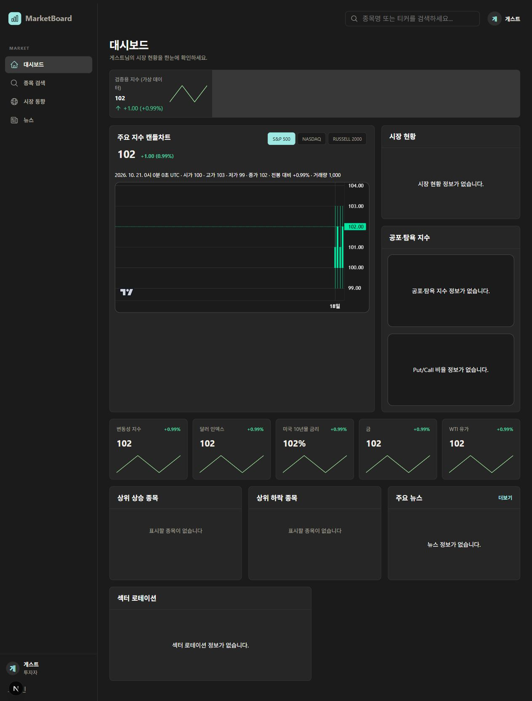

### 남은 범위

- 운영 배포/실제 API 부하·지연 검증, OS 네트워크 단절 재현은 수행하지 않았다.
- 로그인 복귀, 메타데이터·OG, 시점·출처 표시, 목록/차트 버튼 레이아웃, 뉴스 중복 정리는 이후 작업이다.
- 관심종목의 개별 추가·제거 및 기타 개인화 화면의 요청 처리는 이번 공통 읽기 영역 수정에 포함하지 않았다.

## 2026-10-23 후속: 데이터 시점·출처 및 모바일 레이아웃

- 지수·거시경제·시장 심리·시장 폭·섹터·종목 목록·종목 상세에 출처와 기준 시각 안내를 추가했다. 시간대가 명시된 시각은 UTC로 통일하고 날짜 전용 값은 날짜로 유지한다. 시간대가 없거나 잘못된 값은 임의 해석하지 않는다.
- 시장 폭의 스냅샷 날짜와 서버 산출 시각을 구분했다. 일봉 데이터는 실시간 시세가 아님을 알리고, 시세 연결 상태가 가격의 최신성을 보장하지 않음을 표시했다.
- 현재 API가 원 제공자나 시각을 제공하지 않는 시세·옵션·섹터 항목은 `미제공`으로 표시한다. 백엔드 계약 확장은 이번 범위에 포함하지 않았다.
- 모바일 상단 검색창 공간, 종목 필터 줄바꿈, 상세 차트 버튼 배치와 사이드바 스크롤을 개선했다. 넓은 종목 표는 내부 가로 스크롤을 유지한다.

### 검증 결과와 한계

- TypeScript, 변경 영역 ESLint, 프로덕션 빌드 통과. 날짜 처리 3개·리소스 상태 3개·인증 갱신 5개 테스트 총 11개 통과.
- 로컬 Next 서버와 `resource-http-fixture.py --normal` 가상 데이터로 브라우저 확인. 시장 화면 360px/430px에서 문서 clientWidth와 scrollWidth가 각각 345/345, 415/415로 일치했다. 종목 목록 360px도 345/345로 페이지 가로 넘침이 없었다.
- 출처·UTC 시각·미제공 안내·서버 산출 시각 분리와 모바일 검색창/표 스크롤을 확인했다. fixture의 시세 경로가 history 요청을 가로채던 부분도 수정했다.
- 로그인 후 필터와 종목 상세 차트 컨트롤의 시각 검증, 실제 모바일 기기 검증, 운영 API 연동 및 배포는 수행하지 않았다. 위 자동 검사 통과와 구분한다.

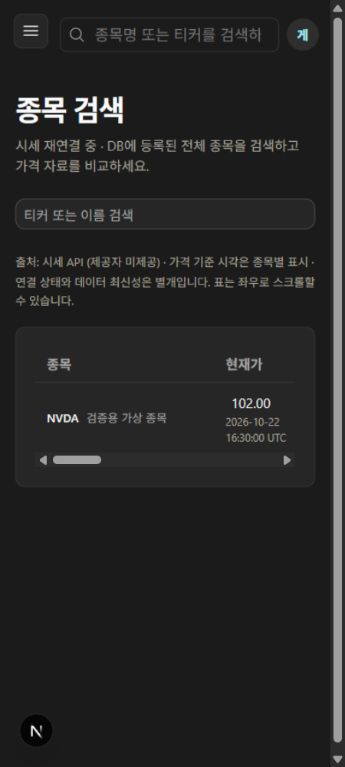
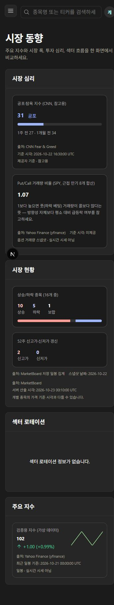

## 2026-10-23 후속: Docker 실제 연동 및 로그인 복귀

### 실행 환경

- 기존 `mysql-container`와 별개로 `compose.local.yml`의 로컬 스택을 빌드·실행했다. 기존 볼륨을 보존했다.
- frontend `localhost:13100`, backend `localhost:18081`, collector `localhost:18001`, MySQL `13308`, Redis `16380`. 5개 컨테이너 실행 및 MySQL·Redis·backend healthy 확인.
- 백엔드 로그: Flyway 46개 migration 검증 성공, 현재 스키마 버전 46, 추가 migration 불필요. 이는 기존 볼륨 검증이며 빈 DB에서의 신규 설치 검증은 아니다.
- 로그인 복귀는 기존 브라우저 사용자 세션을 유지하기 위해 별도 `localhost:3100` 프런트엔드와 실제 Docker backend로 검증했다. 로컬 시드 계정만 사용했다.

### 추가 구현

- 제한 화면 진입 시 허용된 내부 pathname을 탭 세션에 보관하고 로그인 성공 후 한 번 소비해 복귀한다. 외부 URL, 인증 화면, 인코딩·역슬래시·상대경로 우회는 거부한다.
- 이메일 로그인과 Google callback에 동일한 복귀 처리를 연결했다. 저장소 사용이 불가능하면 기존 `/review` 기본 이동을 유지한다. 쿼리·해시·미완료 쓰기 작업은 저장하거나 자동 실행하지 않는다.
- 종목 목록에서 상세·관심종목의 로그인 필요 여부를 사전 안내하고, 로그인 화면에는 선택 종목과 복귀 안내를 표시한다. 로그인 폼 폭을 모바일 화면에 맞췄다.

### 검증

- 로컬 Docker 프로덕션 빌드 및 실행 성공. TypeScript, 변경 영역 ESLint, `git diff --check` 통과.
- 날짜 3개 + 리소스 상태 3개 + 인증 갱신 5개 + 로그인 복귀 3개, 총 14개 테스트 통과.
- 실제 API 기반 로그인 상태 종목 검색 360px: clientWidth/scrollWidth 345/345. 검색 필터와 시세 연결·기준 시각 미제공 표시 확인.
- 종목 상세 일봉→분봉 조작 및 분봉 데이터 표시 확인. 분봉 최신 timestamp가 2026-10-16인 저장 자료였으므로 연결 상태와 데이터 최신성을 동일시하지 않는다.
- NVDA 제한 화면 → 종목 맥락이 있는 로그인 안내 → 로컬 계정 로그인 → `/symbols/NVDA` 복귀 성공. 3개월 일봉 차트 로드 후 최근 봉 2026-10-22 04:00:00 UTC 확인.
- 상세 화면 360px와 430px에서 각각 345/345, 415/415로 문서 가로 넘침 없음 확인.

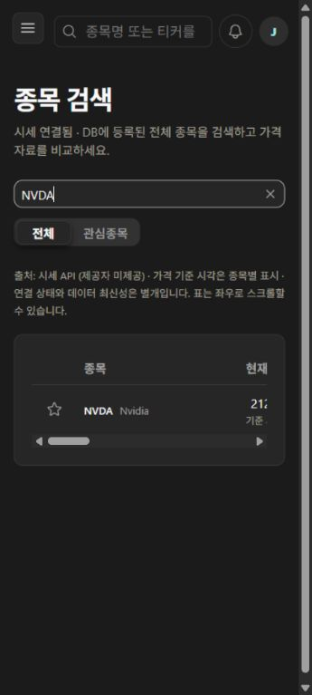
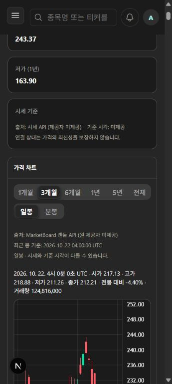

### 남은 단계

- 실제 Google OAuth 왕복, 로그인 실패 후 재시도·가입·취소 흐름의 종합 브라우저 검증은 남아 있다.
- 물리 모바일 기기, 운영 배포, 실제 공유 미리보기는 검증하지 않았다. 커밋·푸시는 수행하지 않았다.
- 다음 구현 후보는 A04 페이지 역할 분리, A07 경로별 메타데이터, A09 뉴스 반복 콘텐츠 정리다. A05의 누락 제공자·원본 시각은 백엔드 계약 확장이 필요하다.

## 2026-10-23 후속: A07 공개 페이지 메타데이터

- 기존 전역 description `실시간 종목 리스트`를 서비스 설명으로 교체했다.
- 서버 layout에서 `/dashboard`, `/market`, `/stock-list`, `/news` 각각의 title·description·canonical·OG·Twitter Card를 제공한다. 기존 클라이언트 화면과 인증 동작은 유지한다.
- canonical과 OG URL은 운영 주소 `https://marketboard.duckdns.org`의 해당 경로를 사용한다. 추적 쿼리와 로컬 호스트 주소를 포함하지 않는다. 루트에는 canonical을 두지 않아 로그인 등 다른 경로로 상속되지 않는다.
- `/share-image`에 1200×630 공통 PNG를 정적으로 생성한다. 가격·사용자 정보·외부 데이터 요청을 포함하지 않는다.

| 경로 | title |
| --- | --- |
| `/dashboard` | 시장 대시보드 · MarketBoard |
| `/market` | 시장 동향 · MarketBoard |
| `/stock-list` | 종목 검색 · MarketBoard |
| `/news` | 시장 뉴스 · MarketBoard |

검증: Docker 프로덕션 빌드(TypeScript 포함), 변경 영역 ESLint, `git diff --check` 통과. `frontend/tests/metadata-http.py`를 로컬 프로덕션 서버에서 실행해 일반 브라우저·Twitterbot 두 User-Agent × 4개 경로의 JavaScript 실행 전 HTML을 검증했다. 제목·설명·canonical·OG·Twitter 일치, 중복 태그 없음, 쿼리 제외, 로그인 페이지 canonical 미상속, 공유 이미지 MIME·PNG 헤더·1200×630 크기를 확인했다. 브라우저에서도 이미지가 잘림 없이 렌더링되는 것을 확인했다.

재실행: `cd frontend` 후 `rtk proxy python -X utf8 tests/metadata-http.py http://127.0.0.1:13100`.

운영 배포와 실제 카카오톡·Slack 등의 공유 카드/캐시 갱신은 미검증이다. 공개 수치의 SSR/ISR(A12)과 비공개·동적 종목별 메타데이터 확장은 이번 범위가 아니다.

## 2026-10-23 후속: A09 뉴스 정리 → A04 화면 역할 분리

### A09

- 같은 URL 또는 같은 출처·정규화 제목의 중복 기사를 순서를 유지하며 제거한다. 다른 출처의 독립 기사는 보존한다. 대시보드의 4건 제한은 중복 제거 후 적용한다.
- 대소문자·공백·문장부호 차이만 있는 제목 반복 설명은 생략하고, 추가 사실이 있는 설명은 유지한다. 의미 기반 유사 기사 통합은 하지 않는다.
- 반복 이미지 URL은 숨기고 출처 텍스트를 유지한다. 요약 목록은 이미지 없이 제목 중심으로 표시한다. 모바일·요약 목록에서도 발행 시각을 UTC와 함께 표시한다.
- 공통 NewsList를 이용하는 일반 뉴스·종목 뉴스·대시보드에 적용된다.

### A04

- 대시보드: 주요 지수 4개, 대표 차트, 상승·하락·보합 요약, 공포·탐욕 요약, 상승/하락 종목, 뉴스 4건, 관심종목을 유지한다. 요약에도 출처·기준 시각·오류/재시도를 유지한다.
- 시장 동향: 심리 과거 비교와 Put/Call, 52주 신고가·신저가, 거시 지표 5개, 섹터 1일·1주·1개월 표와 주요 지수를 제공한다. 거시 항목이 주요 지수 목록에도 반복되던 부분과 섹터 제목 중복을 제거했다.
- 요약의 더보기에서 `/market#breadth`, `/market#sentiment`로 연결한다. 비로그인 사용자에게 실제 관심종목 기능으로 연결되는 CTA를 표시한다.
- 섹터 설명은 실제 표에 맞게 ETF 기간별 수익률·1개월 정렬로 정리했다. 지원하지 않는 기간이나 새 계산은 추가하지 않았다. A07 설명도 변경된 페이지 역할에 맞췄다.

### 검증

- 뉴스 정규화/추가 설명 보존/독립 출처 보존 테스트 3개 통과. TypeScript, 변경 영역 ESLint, Docker 프로덕션 빌드 및 `git diff --check` 통과.
- 메타데이터 HTTP 회귀 검증(4개 경로 × 일반·Twitterbot User-Agent) 통과.
- 실제 Docker API 화면에서 반복 설명 생략과 추가 설명 유지, 모바일 발행 시각 표시, 시장 상세 링크 이동, 심리 과거 비교·Put/Call·52주 수치·거시 5개·기존 섹터 기간 표를 확인했다.
- 360px 뉴스·대시보드·시장 화면 모두 clientWidth/scrollWidth 345/345. 1440px 대시보드 1425/1425로 페이지 가로 넘침 없음 확인.
- 운영 배포·실제 모바일 기기·외부 기사 원문 정확성은 검증하지 않았다. 퍼지 중복 판정·번역·신규 데이터 수집은 범위 밖이다.

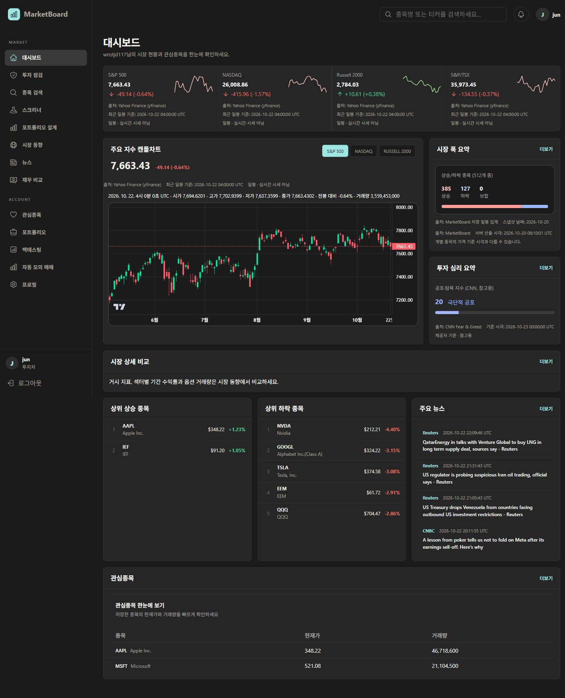
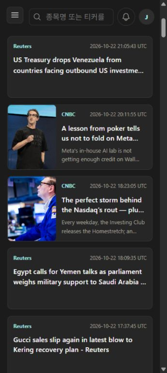

## 2026-10-23 후속: A08 모바일·접근성·고지

- 닫힌 모바일 메뉴를 키보드 탐색에서 제외하고 열린 메뉴의 초점 순환, Escape 닫기, 열기 버튼으로 초점 복귀, 배경 inert 및 스크롤 잠금을 적용했다. 본문 바로가기, focus-visible 표시, reduced-motion 메뉴 전환을 추가했다.
- 공통 푸터에 참고용 정보·투자 판단 책임·데이터 지연/오류·시점 확인 안내와 이용약관/개인정보 링크를 제공한다. 특정 법적 요건 충족을 보장하는 검토는 아니다.
- 로그인 취소 링크를 추가하고 취소 시 보관된 복귀 경로를 지운다. 시장 개요로 나가는 경우도 동일하게 정리한다.
- Docker 화면 320px에서 시장·종목 상세는 문서 폭 305/305, 로그인은 320/320으로 가로 넘침이 없었다. 키보드 메뉴 열기, Shift+Tab/Tab 순환, Escape, 초점 복귀, 본문 이동, 푸터 초점 표시를 확인했다.
- 별도 3100 포트와 실제 Docker API·로컬 시드 계정으로 로그인 실패 안내 및 NVDA 복귀 경로 유지 → 정상 비밀번호 재시도 → NVDA 복귀를 확인했다. Space로 3개월 차트 선택, 검색 Enter로 AAPL 이동, 로그인 취소 후 공개 종목 목록 이동도 확인했다. 기존 13100 사용자 세션은 로그아웃하지 않았다.
- 640×400 화면에서도 625/625로 넘침이 없었다. 이는 축소된 가용 화면의 재배치 검증이며 실제 브라우저 200% 확대 검증은 아니다. 현재 브라우저 도구가 확대 제어를 제공하지 않아 실제 확대·물리 기기·스크린리더 검증은 남아 있다.
- 로그인 복귀 4개·인증 갱신 5개 테스트, TypeScript, 변경 영역 ESLint, Docker 프로덕션 빌드, diff 공백 검증 통과.

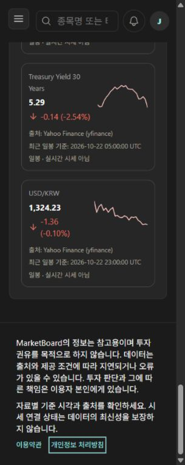
